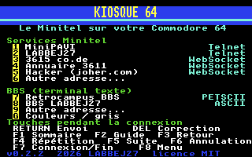
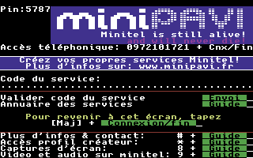
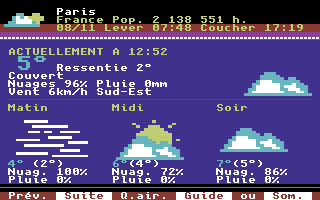
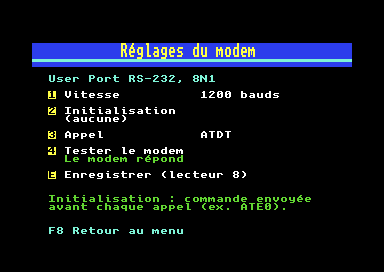

# Kiosque 64

**Le Minitel sur votre Commodore 64.** Kiosque 64 transforme un C64 Ultimate en Minitel couleur, branché sur les services Vidéotex d'aujourd'hui (MiniPAVI, 3615 co.de, 3611…) par Internet, et sert aussi de terminal pour les BBS en PETSCII ou en ASCII.

*English version below.*

| Menu | MiniPAVI | MiniMeteo |
|---|---|---|
|  |  |  |

*Captures faites sur un vrai C64 Ultimate.*

## Fonctions

- **Émulation Minitel (Vidéotex)** : texte, semi-graphiques joints et disjoints, 8 couleurs (ou niveaux de gris comme un Minitel 1), double hauteur, double largeur, double taille, inversion, soulignement, clignotement, masquage, rangée de service, mode rouleau, accents français.
- **Connexion directe par le réseau du C64 Ultimate**, sans modem ni passerelle : TCP brut, telnet ou **WebSocket** (`ws://`).
- **Carnet d'adresses** : MiniPAVI et la passerelle LABBEJ27 (telnet), 3615 co.de, l'annuaire 3611 et joher.com (WebSocket), Retrocampus BBS, le BBS LABBEJ27, et n'importe quelle autre adresse.
- **Terminal BBS** en PETSCII ou en ASCII.
- **Clavier Minitel** sur les touches du C64, accents avec `C=` comme dans [Plume](https://github.com/labbej27/plume64).
- Éditions **française** et **anglaise**, en cartouche `.crt` ou en programme `.prg`.

## Utilisation

1. Activez le **Command Interface** du C64 Ultimate, une fois pour toutes (voir ci-dessous).
2. Lancez `dist/kiosque-fr.crt` (ou `kiosque-en.crt`, ou les `.prg`).
3. Choisissez un service avec les touches `1` à `9`.

| Touche C64 | Touche Minitel |
|---|---|
| `RETURN` | Envoi |
| `DEL` | Correction |
| `F1` / curseur gauche | Sommaire |
| `F2` | Guide |
| `F3` / curseur haut | Retour |
| `F4` / curseur droite | Répétition |
| `F5` / curseur bas | Suite |
| `F6` | Annulation |
| `F7` | Connexion/Fin |
| `F8` | Retour au menu de Kiosque 64 |
| `C=` + `E` / `R` / `T` | é / è / ê |
| `C=` + `A` / `Q` | à / â |
| `C=` + `C` | ç |
| `C=` + `U` / `Y` | ù / û |
| `C=` + `O` / `I` / `K` / `L` | ô / î / ï / ë |
| `C=` + `P` | œ |

Comme sur un Minitel, le clavier est en majuscules par défaut ; `Shift` donne les minuscules, sauf si le service passe le clavier en minuscules. Ce que vous tapez s'affiche localement (écho local), sauf si le service le coupe pour renvoyer lui-même les caractères.

### Activer le Command Interface

Kiosque 64 passe par le « Command Interface » du C64 Ultimate pour accéder au réseau. Il est désactivé d'origine ; sans lui, Kiosque affiche « Activez le Command Interface ».

1. **Ouvrez le menu du C64U** : poussez l'interrupteur multifonction (le bouton marche/arrêt) vers le haut et relâchez-le.
2. Avec les touches du curseur, choisissez **Memory & ROMs** (« Memory Configuration » dans les firmwares plus récents) et validez avec `RETURN`.
3. Descendez jusqu'à **Command Interface**, juste sous les réglages de la REU, appuyez sur `RETURN` et choisissez **Enabled**.
4. Quittez le menu avec `RUN/STOP`.
5. Quand le C64U propose d'enregistrer les réglages en mémoire flash, appuyez sur **`Y`**. Sans cette étape, le réglage est perdu à l'extinction.

Dans le menu avancé (`F2` depuis le menu principal), le même réglage se trouve dans **C64 and Cartridge Settings → Command Interface**.

Avec l'API REST de l'Ultimate (réseau local), on peut aussi faire :

```sh
curl -X PUT "http://IP-DU-C64/v1/configs/C64%20and%20Cartridge%20Settings/Command%20Interface?value=Enabled"
curl -X PUT "http://IP-DU-C64/v1/configs:save_to_flash"
```

### Édition modem v0.2 (C64 d'origine)

Sans C64 Ultimate, Kiosque 64 passe par un **modem WiFi**, comme ceux qu'on utilise avec CCGMS. La version 0.2 prend en charge les trois façons de brancher un modem sur un C64 :

| Interface | Branchement | Vitesses | Fichier |
|---|---|---|---|
| **User Port** | RS-232 standard du port utilisateur : réception broches B et C, émission broche M | 300 à 2400 bauds | `.crt` ou `.prg` |
| **UP9600** | câblage de Daniel Dallmann : en plus, broche 7 reliée à C, broche L à 6, émission sur la broche 5 | 300 à 9600 bauds | `.crt` ou `.prg` |
| **SwiftLink / Turbo232** | cartouche ACIA 6551 en `$DE00` ou `$DF00` | 300 à 38 400 bauds | `.prg` seulement : la cartouche occupe le même port |

Prenez `dist/kiosque-modem-fr.crt` (format EasyFlash, compatible Kung Fu Flash) ou `dist/kiosque-modem-fr.prg`, puis réglez votre modem avec la touche **M** du menu.



- **Réglages** : **1** interface, **2** vitesse, **3** chaîne d'initialisation (envoyée avant chaque appel, par exemple `ATE0`), **4** préfixe d'appel (`ATDT` par défaut), **5** test du modem, **6** terminal, **E** enregistrement dans `KIOSQUE.CFG` sur le lecteur 8. Les réglages sont relus au démarrage ; ceux de la version 0.1 aussi.
- **Terminal du modem** (touche 6, depuis la v0.3) : on tape directement au modem (`AT`, `ATI`, `AT&W`…) et on voit ses réponses, comme dans CCGMS, pour le configurer. `F8` revient aux réglages sans raccrocher ni envoyer `+++`.
- **Commandes AT** : Kiosque n'utilise que celles qui sont communes aux modems WiFi pour C64 (firmwares ESP8266 de jsalin, Zimodem et dérivés) : `AT`, `ATDT hôte:port`, `CONNECT`, `NO CARRIER`, puis `+++` et `ATH` pour raccrocher. Le telnet et le WebSocket sont gérés par Kiosque lui-même, que le modem s'en occupe ou non.
- **Contrôle de flux** : la plupart des modems WiFi n'en ont pas. Kiosque reçoit donc dans une mémoire tampon de 8 Ko, assez pour une page Minitel entière quand le dessin à 1 MHz prend du retard. Avec SwiftLink, Kiosque relâche en plus la ligne RTS quand le tampon se remplit.
- **UP9600** : pendant la connexion, l'horloge à 60 Hz du KERNAL passe sur le timer B du CIA 1, car le timer A cadence l'émission. Tout revient en place au raccrochage.

Les pilotes ([`src/rs232.s`](src/rs232.s)) sont écrits pour Kiosque, d'après les fiches techniques du 6526 et du 6551 et la [description publique d'UP9600](https://www.pagetable.com/?p=1656). La couche modem ([`src/modem.c`](src/modem.c)) remplace le Command Interface ; tout le reste (telnet, WebSocket, Vidéotex) est commun aux deux éditions. `make modem` fabrique les cartouches et les `.prg`.

### WebSocket et chiffrement

Le C64 ne sait pas faire de TLS : seules les adresses `ws://` (non chiffrées) sont joignables, pas les `wss://`. Pour les passerelles MiniPAVI, le plus simple est leur accès telnet (`go.minipavi.fr:516`, `minitel.labbej.fr:8180`).

### Autre adresse

Touches `6` (Minitel) et `9` (BBS) : un champ vide s'ouvre en bas de l'écran ; `RETURN` valide, `F8` annule.


- `minitel.labbej.fr:8180` : telnet ;
- `ws://hôte:port/chemin` : WebSocket ;
- pour un BBS, `hôte:port` (telnet, port 23 par défaut).

## Matériel testé

| Configuration | État |
|---|---|
| Commodore 64 Ultimate (firmware 1.1.0), WiFi, à 1 MHz et à 64 MHz | Testé (v0.1 ; v0.2.2 : MiniPAVI, LABBEJ27, adresse saisie à la main, BBS LABBEJ27 en 40x25, fin de connexion par F7) : MiniPAVI et LABBEJ27 (telnet), 3615 co.de, 3611 et joher.com (WebSocket), Retrocampus BBS, BBS LABBEJ27 ; cartouche et .prg |
| VICE 3.10 (affichage seulement, pas de réseau) | Testé |
| Édition modem dans VICE 3.10, avec un faux modem relié à Internet ([`tests/modem/fakemodem.py`](tests/modem/fakemodem.py)) | Testé en User Port (1200 et 2400 bauds), UP9600 (9600 bauds) et SwiftLink (9600 et 38 400 bauds) : MiniPAVI, LABBEJ27, MiniMeteo avec saisie, 3615 co.de (WebSocket), Retrocampus BBS, BBS LABBEJ27, raccrochage, réglages enregistrés et relus, aucun octet perdu |
| C64 d'origine avec Kung Fu Flash 2 et modem WiFi ESP8266 (User Port, 2400 bauds) | Testé : édition modem v0.1 et v0.2 |
| UP9600 et SwiftLink sur du vrai matériel | **Pas encore testés** : retours bienvenus |

## Compiler

Outils : `make`, `python3`, [cc65](https://github.com/cc65/cc65). Sur macOS : `brew install cc65`, puis `make`. Les cartouches sont dans `build/`.

## Comment c'est fait

- **Réseau** : le Command Interface du C64 Ultimate (registres `$DF1C-$DF1F`) ouvre les connexions TCP ; Kiosque y ajoute telnet et WebSocket ([`src/net.c`](src/net.c)).
- **Vidéotex** : un décodeur écrit d'après la norme Télétel ([`src/vdt.c`](src/vdt.c)), avec le modèle d'attributs « série » du Minitel (fond et soulignement appliqués par délimiteur, zone par zone).
- **Affichage** : écran bitmap 320×200, chaque case Minitel a sa couleur de texte et de fond, comme sur le C64 ([`src/gfx.s`](src/gfx.s)).
- **Cartouche** : format Magic Desk, qui laisse libre la zone `$DF00` utilisée par le Command Interface.
- **Inspiration** : [EMinEx](https://github.com/ludosevilla/EMinEx) (Minitel sur MSX) et [CCGMS](https://github.com/mist64/ccgmsterm) (terminal BBS). Aucun code n'en est repris : Kiosque 64 est écrit de zéro.

## Licence

[MIT](LICENSE). La police unscii est dans le domaine public ; la bibliothèque d'exécution de cc65 est sous licence zlib (voir [NOTICE](NOTICE)). « Minitel » est une marque d'Orange ; Kiosque 64 n'est pas lié à Orange.

---

# Kiosque 64 (English)

**Minitel on your Commodore 64.** Kiosque 64 turns a C64 Ultimate into a colour Minitel connected to today's French Videotex services (MiniPAVI, 3615 co.de, 3611…) over the Internet. It is also a PETSCII or ASCII terminal for BBSes.

## Features

- **Minitel (Videotex) emulation**: text, joined and separated mosaics, 8 colours (or Minitel 1 style greys), double height/width/size, inverse, underline, blink, conceal, status row, scroll mode, French accents.
- **Direct connection through the C64 Ultimate's network**, no modem or bridge: raw TCP, telnet or **WebSocket** (`ws://`).
- **Phone book** with MiniPAVI and the LABBEJ27 gateway (telnet), 3615 co.de, the 3611 directory and joher.com (WebSocket), Retrocampus BBS, the LABBEJ27 BBS, and any other address.
- **BBS terminal** in PETSCII or ASCII.
- French and English editions, as `.crt` cartridges or `.prg` programs.

## Usage

First enable the **Command Interface**, once and for all (it is off by default):

1. **Open the C64U Menu**: push the Multi Function Switch (the power switch) upward and release it.
2. With the cursor keys, select **Memory & ROMs** ("Memory Configuration" in newer firmware) and press `RETURN`.
3. Go down to **Command Interface**, just below the REU settings, press `RETURN` and choose **Enabled**.
4. Leave the menu with `RUN/STOP`.
5. When the C64U offers to save the settings to flash memory, press **`Y`**. Otherwise the setting is lost at power-off.

In the advanced menu (`F2` from the main menu), the same setting is under **C64 and Cartridge Settings → Command Interface**.

Then start `dist/kiosque-en.crt` and pick a service with `1`-`9`. Keys: `RETURN` Envoi, `DEL` Correction, `F1` Sommaire, `F2` Guide, `F3` Retour, `F4` Répétition, `F5` Suite, `F6` Annulation, `F7` Connexion/Fin, `F8` back to the menu. Accented letters use `C=` plus a letter (see the table above).

The C64 cannot do TLS, so only `ws://` addresses work, not `wss://`.

### Modem edition v0.2 (original C64)

Without a C64 Ultimate, Kiosque 64 talks to a **WiFi modem**, the kind people use with CCGMS. Version 0.2 supports the three ways a modem connects to a C64:

| Interface | Wiring | Speeds | File |
|---|---|---|---|
| **User Port** | the C64's standard user port RS-232: receive on pins B and C, transmit on pin M | 300 to 2400 baud | `.crt` or `.prg` |
| **UP9600** | Daniel Dallmann's wiring: also pin 7 bridged to C, pin L to 6, transmit on pin 5 | 300 to 9600 baud | `.crt` or `.prg` |
| **SwiftLink / Turbo232** | 6551 ACIA cartridge at `$DE00` or `$DF00` | 300 to 38,400 baud | `.prg` only: it uses the cartridge port |

Use `dist/kiosque-modem-en.crt` (EasyFlash, works with a Kung Fu Flash) or `dist/kiosque-modem-en.prg`, then set up your modem with **M** in the menu: **1** interface, **2** speed, **3** init string, **4** dial prefix, **5** test, **6** terminal (type AT commands straight to the modem, like in CCGMS; `F8` goes back without hanging up), **E** save `KIOSQUE.CFG` on drive 8 (read back at startup, version 0.1 files included).

Kiosque only uses the AT commands all C64 WiFi modems share (`AT`, `ATDT host:port`, `CONNECT`, `NO CARRIER`, `+++`, `ATH`) and handles telnet and WebSocket itself. Most WiFi modems have no flow control, so Kiosque receives into an 8 KB buffer, enough for a whole Minitel page; with SwiftLink it also drops RTS when the buffer fills up. With UP9600, the KERNAL's 60 Hz interrupt moves to CIA 1 timer B while connected.

Tested on an original C64 with a Kung Fu Flash 2 and an ESP8266 modem (User Port, 2400 baud, versions 0.1 and 0.2), and in VICE 3.10 with an emulated modem ([`tests/modem/fakemodem.py`](tests/modem/fakemodem.py)) on User Port, UP9600 at 9600 and SwiftLink at 9600 and 38,400 baud. UP9600 and SwiftLink have not been tried on real hardware yet: feedback welcome. `make modem` builds the cartridges and `.prg` files.

## Building

`make`, `python3` and [cc65](https://github.com/cc65/cc65), then `make`.

## License

[MIT](LICENSE). Inspired by EMinEx and CCGMS, but written from scratch. "Minitel" is a trademark of Orange; Kiosque 64 is not affiliated with Orange.
